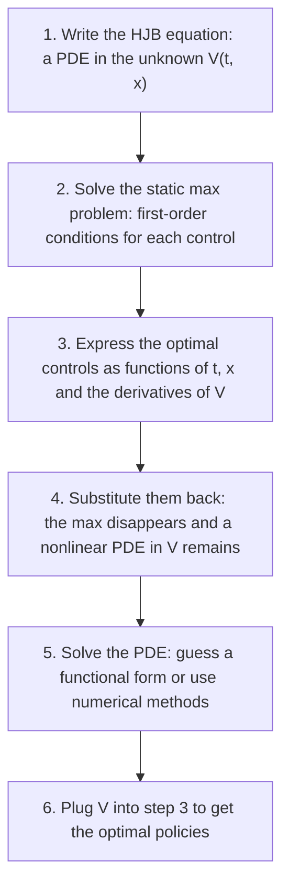
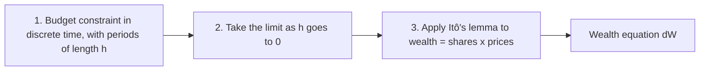
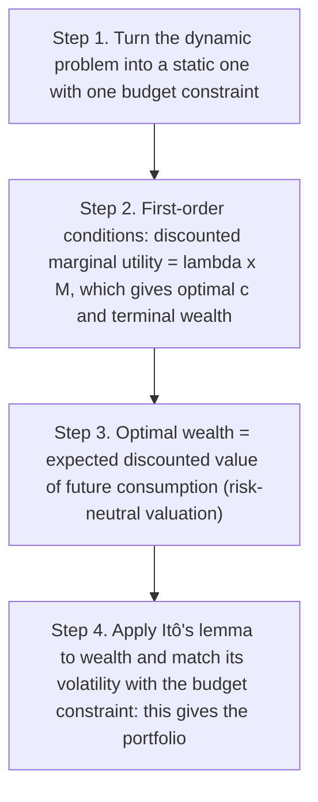
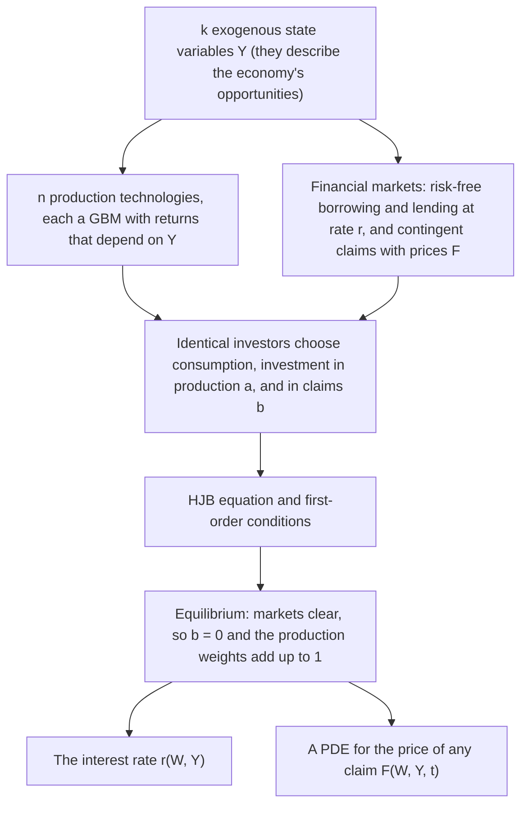
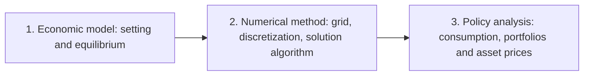
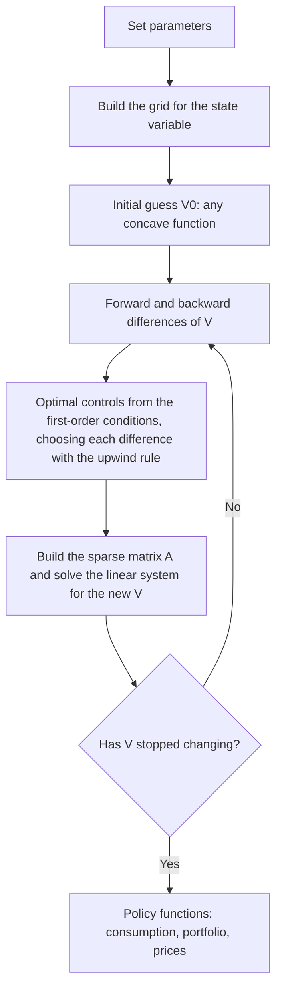
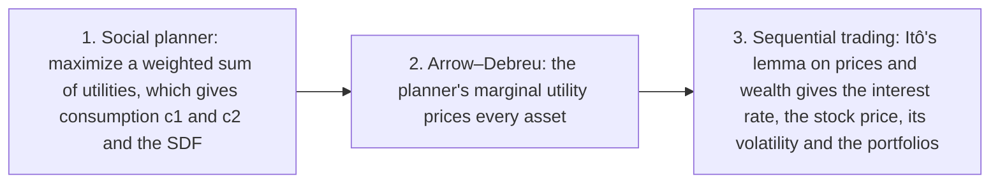

> These are my personal study notes for **Heterogeneous Agents in Asset Pricing**, a graduate course using a continuous-time approach, taught by Professor Hamilton Galindo in the M.Sc. in Economic Engineering at the Universidad Nacional de Ingeniería (UNI), Fall 2024. They follow his lectures and his book draft *Heterogeneous Agents in Asset Pricing*, explained in my own words and as intuitively as I could: the models and results are not my original work, and any errors are mine. The figures are my own, drawn with illustrative parameters. Problem-set and exam solutions are not included.

## The big picture

**The question of the course:** does it matter for asset prices (interest rates, stock prices, risk premia) that investors are *different* from each other? Standard asset pricing uses one "representative" investor. Here we let investors differ and ask how prices change.

The course has three blocks: **tools** (how to describe and control random variables in continuous time), a **framework** (a general equilibrium model where prices come out of investors' decisions), and **heterogeneity** (models with different investors, solved numerically).

### Three ways investors can differ

| Source of heterogeneity | Where it enters the model | Example question |
| --- | --- | --- |
| Preferences | the utility function (for example, different risk aversion or habits) | How does the term structure of interest rates change when some investors are more risk averse? |
| Beliefs | the expectation operator: investors disagree about the drift of a variable | How do disagreements affect interest rates, prices and trading? |
| Labor income risk | the income process, with shocks that cannot be insured | Can uninsurable income risk explain high risk premia? |

Professor Galindo's survey classifies 63 articles published between 1975 and 2022 by these sources. A clear pattern appears: preference and belief models are mostly written in continuous time with complete markets, while labor-income-risk models are almost all in discrete time with incomplete markets.

| Source | Articles | Continuous time | Complete markets |
| --- | --- | --- | --- |
| Preferences | 18 | 15 | 12 |
| Beliefs | 19 | 13 | 17 |
| Labor income risk | 20 | 1 | 0 |
| Combinations of two sources | 6 | 4 | 4 |
| **Total** | **63** | **33** | **32** |

**A typical heterogeneous-agent problem.** Investor $$i$$ chooses consumption and a portfolio to maximize expected utility, given how three kinds of variables move:

$$
\max \; \mathbb{E}^i_t \left[ \int_t^T U(s, c_{is}, X_s)\, ds + \Phi(W_{iT}) \right]
$$

$$
dW_{is} = dY_{is} + \mu_W\, ds + \sigma_W\, dZ_s \quad \text{(wealth)}, \qquad
dX_s = \mu_X\, ds + \sigma_X\, dZ_s \quad \text{(exogenous state)}, \qquad
dY_{is} = \mu_Y\, ds + \sigma_Y\, dZ^y_{is} \quad \text{(labor income)}
$$

Each source of heterogeneity changes one piece: preferences change $$U$$, beliefs change $$\mathbb{E}^i$$, and labor income risk changes $$dY_i$$.

## Stochastic processes

### The intuition

A **stochastic process** is a random variable that moves through time: a whole *path* of values instead of a single number. Stock prices, wealth and output are all modeled this way.

To define one rigorously we need a **probability space** $$(\Omega, \mathcal{F}, P)$$:

| Object | What it is | Intuition |
| --- | --- | --- |
| Sample space Ω | all possible outcomes ω | everything that could happen |
| σ-algebra 𝓕 | the family of events we can talk about | the questions we are allowed to ask |
| Probability P | assigns a number in [0, 1] to each event | how likely each event is |
| Filtration 𝓕ₜ | the information available at time t | what we know so far (it grows with time) |
| Random variable X(ω) | a function from outcomes to numbers | turns an outcome into a value, such as a price |

In models with **heterogeneous beliefs**, the filtration and the probability measure matter a lot: investors can see the same information but use different probabilities.

### Standard Brownian motion: the building block

A standard Brownian motion $$Z_t$$ (or Wiener process) is the basic source of randomness. It satisfies four conditions:

1. It starts at zero: $$Z_0 = 0$$.
2. Increments are normal: $$Z_{t'} - Z_t \sim N(0,\, t'-t)$$, so the variance grows with the length of the interval.
3. Increments over non-overlapping intervals are independent.
4. Paths are continuous (no jumps).

Any process can then be written as "a trend plus accumulated shocks":

$$
X_t = X_0 + \underbrace{\int_0^t \mu_s\, ds}_{\text{ordinary integral (trend)}} + \underbrace{\int_0^t \sigma_s\, dZ_s}_{\text{Itô integral (shocks)}}
\qquad \Longleftrightarrow \qquad
dX_t = \mu_t\, dt + \sigma_t\, dZ_t
$$

The **drift** $$\mu$$ says where the process is heading on average; the **volatility** $$\sigma$$ says how strongly it is pushed around by the shocks.

### A family of processes

| Process | Drift μ and volatility σ | Equation | Typical use |
| --- | --- | --- | --- |
| Arithmetic Brownian motion (ABM) | constants | dX = μ dt + σ dZ | variables that can be negative |
| Time-inhomogeneous ABM | functions of time only | dX = μ(t) dt + σ(t) dZ | seasonal or deterministic trends |
| Diffusion process | functions of t and the current X | dX = μ(t, X) dt + σ(t, X) dZ | most models in the course (they are Markov) |
| Geometric Brownian motion (GBM) | proportional to X | dX = μX dt + σX dZ | prices, output, endowments (always positive) |
| Itô process | can depend on the whole past | dX = μ(t, Xₜ, Xₜ₋₁, …) dt + σ(…) dZ | the most general case |



## Stochastic calculus

### Why ordinary calculus is not enough

In ordinary calculus, $$(dt)^2$$ is so small that we ignore it. A Brownian shock is different: over a short interval $$dt$$ its typical size is $$\sqrt{dt}$$, so its *square* is of order $$dt$$ and cannot be ignored. That is the whole reason for a new calculus.

| Product | Value | Why |
| --- | --- | --- |
| dt · dt | 0 | second-order small |
| dt · dZ | 0 | of order dt to the power 3/2 |
| dZ · dZ | dt | the variance of dZ is dt |
| dZᵢ · dZⱼ (independent shocks) | 0 | independent shocks do not co-move |

### Martingales

A **martingale** is a process whose best forecast is its current value: $$\mathbb{E}_t[M_{t'}] = M_t$$ — a "fair game". Two results connect martingales and Brownian motion:

- Every Itô integral $$\int_0^t \sigma_u\, dZ_u$$ is a martingale (pure shocks have no predictable direction).
- **Martingale representation theorem:** every martingale can be written as $$dM_t = \theta_t\, dZ_t$$, that is, it has no drift.

These two facts are the basis of the martingale approach and of risk-neutral pricing.

### Itô's lemma: the chain rule with randomness

If $$dX_t = \mu_t\, dt + \sigma_t\, dZ_t$$ and $$K_t = f(t, X_t)$$, then

$$
df = \left( \frac{\partial f}{\partial t} + \mu_t \frac{\partial f}{\partial X} + \frac{1}{2}\sigma_t^2 \frac{\partial^2 f}{\partial X^2} \right) dt + \sigma_t \frac{\partial f}{\partial X}\, dZ_t
$$

The first two terms are the usual chain rule. The **extra term** $$\tfrac{1}{2}\sigma^2 f_{XX}$$ comes from $$(dZ)^2 = dt$$: when $$f$$ is curved, randomness itself changes its average (Jensen's inequality). A practical way to remember it is a second-order Taylor expansion using the multiplication table:

$$
df = f_t\, dt + f_X\, dX + \tfrac{1}{2} f_{XX}\, (dX)^2, \qquad (dX)^2 = \sigma^2 dt
$$

**Useful rules** for two processes $$X$$ and $$Y$$ driven by the same shock:

$$
d(X+Y) = dX + dY, \qquad d(XY) = X\, dY + Y\, dX + dX\, dY
$$

**Example: the log of a GBM.** If $$dX = \mu X\, dt + \sigma X\, dZ$$ and $$f = \ln X$$, then $$f_X = 1/X$$ and $$f_{XX} = -1/X^2$$, so

$$
d \ln X_t = \left(\mu - \tfrac{1}{2}\sigma^2\right) dt + \sigma\, dZ_t
\quad \Rightarrow \quad
X_t = X_0 \exp\!\left[\left(\mu - \tfrac{1}{2}\sigma^2\right)t + \sigma Z_t\right]
$$

The average of $$X$$ grows at rate $$\mu$$, but the *typical* path grows at the slower rate $$\mu - \sigma^2/2$$. With high volatility the difference is large:



| | Classical calculus | Stochastic calculus |
| --- | --- | --- |
| Integration | Riemann integral | Itô integral |
| Fundamental theorem | derivative of an integral | Itô's lemma (1951) |
| Expected values | not needed | Dynkin's formula: the expected value of f(Xₜ) |
| Second-order terms | vanish | (dZ)² = dt survives |

## Dynamic programming in continuous time

### Three ways to solve a dynamic problem

| Approach | Idea | Used in the course for |
| --- | --- | --- |
| Dynamic programming (Hamilton–Jacobi–Bellman equation) | split the problem into "today" plus "the value of the future" | Merton's problem, CIR (1985), the two-agent model |
| Stochastic maximum principle (Pontryagin) | optimal control with costate variables | not used |
| Martingale approach (Cox and Huang; Karatzas, Lehoczky and Shreve) | turn the dynamic problem into a static one with a single budget constraint | complete-market models, the two-agent model |

### The stochastic optimal control problem

| Ingredient | Symbol | Example (consumption–portfolio problem) |
| --- | --- | --- |
| State variables | Xₜ | wealth Wₜ |
| Control variables | uₜ | consumption cₜ and portfolio weights wₜ |
| Objective | $$\mathbb{E}\left[\int F(s, X, u)\, ds + \Phi(X_T)\right]$$ | discounted utility of consumption |
| Dynamics | dX = μ(t, X, u) dt + σ(t, X, u) dZ | the wealth equation |
| Constraints | h(u) = 0 | weights add up to one; consumption is non-negative |

The **value function** $$V(t, x)$$ is the best expected utility that can be obtained starting from state $$x$$ at time $$t$$.

### The generator: the expected rate of change

For a diffusion $$dX = \mu\, dt + \sigma\, dZ$$, the operator $$\mathcal{A}$$ tells us how fast a function $$F(X)$$ is expected to change:

$$
\mathcal{A}F = \sum_i \mu_i \frac{\partial F}{\partial X_i} + \frac{1}{2}\sum_{i,j} C_{ij} \frac{\partial^2 F}{\partial X_i \partial X_j}, \qquad C = \sigma \sigma'
$$

It is simply the drift part of Itô's lemma. For example, for a GBM and $$F = \ln X$$, $$\mathcal{A}F = \mu - \sigma^2/2$$.

### The Hamilton–Jacobi–Bellman equation

$$
\frac{\partial V}{\partial t} + \max_{u} \Big\{ F(t, x, u) + \mathcal{A}^u V(t, x) \Big\} = 0, \qquad V(T, x) = \Phi(x)
$$

**Intuition:** along the optimal path, *the utility you receive now plus the expected change in your value must add up to zero* — there is no way to improve. In infinite-horizon problems with discounting, the stationary version reads

$$
\rho V = \max_u \Big\{ u(c) + \mathcal{A}^u V \Big\}
\quad \text{or, in words,} \quad
\text{required return on value} = \text{dividend (utility)} + \text{expected capital gain}
$$

like the return on an asset.

### Six steps to solve an HJB equation

With constraints on the controls, a Lagrange multiplier term $$\lambda' h(u)$$ is added inside the max (Kuhn–Tucker conditions); at the optimum it equals zero.

### The classic example: Merton's consumption–portfolio problem

An investor splits wealth between a risk-free asset (return $$r$$) and a stock (expected return $$\alpha$$, volatility $$\sigma$$):

$$
dW_t = \Big[ W_t\big( w_t(\alpha - r) + r \big) - c_t \Big] dt + W_t\, w_t\, \sigma\, dZ_t
$$

The first-order conditions of the HJB equation give two famous rules:

$$
u'(c_t) = V_W \qquad \text{(marginal utility of consuming = marginal value of saving)}
$$

$$
w^* = \frac{-V_W}{W\, V_{WW}} \cdot \frac{\alpha - r}{\sigma^2} = \frac{\alpha - r}{\text{RRA} \cdot \sigma^2}
$$

The share in stocks is the **risk premium divided by risk aversion times variance**: more premium, more stocks; more risk aversion or volatility, fewer stocks. With log utility (RRA = 1), consumption is a constant fraction of wealth: $$c = \rho W$$.



## Wealth dynamics: the budget constraint in continuous time

The budget constraint is the most important equation of any investor's problem. Professor Galindo derives it in three steps:

The result, for an investor with labor income $$Y$$ who holds $$N_i$$ shares of assets with prices $$P_i$$ and dividends $$d_i$$:

$$
dW_t = dY_t - c_t\, dt + \sum_i N_{it}\big( dP_{it} + d_{it}\, dt \big)
$$

**In words:** wealth grows with income and with the total return of the portfolio (price changes plus dividends), and falls with consumption. Written with portfolio weights $$w_i = P_i N_i / W$$, a risk-free asset and prices that follow GBMs:

$$
dW_t = dY_t + \Big[ W_t \Big( \sum_i w_{it} (\alpha_i - r) + r \Big) - c_t \Big] dt + W_t \sum_i w_{it}\, \sigma_i\, dZ_{it}
$$

| Term | Meaning |
| --- | --- |
| dY | labor (non-capital) income |
| W r | return on wealth at the risk-free rate |
| W Σ wᵢ(αᵢ − r) | extra expected return from bearing risk |
| − c | consumption |
| W Σ wᵢσᵢ dZᵢ | risk: wealth moves with the shocks of the assets held |

A subtle point: Itô's lemma applied to "shares × prices" gives the *differential* of wealth, not yet the budget constraint. The budget constraint appears only after combining it with the discrete-time constraint in the limit.

## The martingale approach

Instead of solving a PDE, the martingale approach uses the fact that, **in complete markets**, any consumption plan that costs no more than initial wealth can be financed by trading. The dynamic problem becomes a static one, like choosing consumption in a one-period model:

$$
\max_{c,\, W_T} \; \mathbb{E}\left[ \int_0^T e^{-\rho t} u(c_t)\, dt + \Phi(W_T) \right]
\quad \text{s.t.} \quad
\mathbb{E}\left[ \int_0^T M_t\, c_t\, dt + M_T\, W_T \right] = w_0
$$

Here $$M_t$$ is the **stochastic discount factor** (state-price density): the price today of one unit of consumption in a particular state and date. It falls in good states and rises in bad states:

$$
\frac{dM_t}{M_t} = -r_t\, dt - \theta_t\, dZ_t, \qquad \theta_t = \frac{\alpha_t - r_t}{\sigma_t} \;\; \text{(market price of risk)}
$$

The key first-order condition is

$$
e^{-\rho t}\, u'(c_t) = \lambda\, M_t
$$

**Intuition:** consume more in states where consumption is cheap (low $$M$$) and less where it is expensive. The step from $$P$$ to the risk-neutral measure $$Q$$ uses the Radon–Nikodym derivative and Girsanov's theorem.

| | Dynamic programming | Martingale approach |
| --- | --- | --- |
| Main object | value function V | stochastic discount factor M |
| Equation to solve | nonlinear HJB PDE | static problem plus, often, a linear PDE for prices |
| Markets | complete or incomplete | needs complete markets |
| Portfolio | from the first-order condition | by matching volatilities |
| Typical difficulty | solving the PDE | finding M and then the portfolio |

## A general equilibrium model: Cox, Ingersoll and Ross (1985)

In the models above, asset prices were *given*. In general equilibrium they are *determined* by investors' choices and by the real economy. Cox, Ingersoll and Ross (1985) built the framework that connects the financial and the real sector.

### Assumptions

- One good; no frictions; competitive markets; **complete markets**.
- **State variables** follow diffusions: $$dY = \mu(Y)\, dt + S(Y)\, dZ$$.
- **Production:** investing $$\eta_i$$ units in technology $$i$$ gives $$d\eta_i/\eta_i = \alpha_i(Y)\, dt + g_i(Y)\, dZ$$ (a GBM, so production is never negative and returns are linear in the amount invested).
- **Contingent claims** with prices $$F_i(W, Y, t)$$, dividends $$\delta_i$$ and endogenous expected returns $$\beta_i$$: $$dF_i = (\beta_i F_i - \delta_i)\, dt + F_i h_i\, dZ$$.
- Identical investors, so in equilibrium nobody holds claims in net terms ($$b = 0$$) and all wealth is invested in production ($$\sum a_i = 1$$).

### Result 1: the equilibrium interest rate

$$
r = \underbrace{a^{*\prime}\alpha}_{\substack{\text{expected return of the}\\ \text{optimal production portfolio}}}
- \underbrace{\left(\frac{-W V_{WW}}{V_W}\right) \frac{\operatorname{var}(dW)}{W^2\, dt}}_{\text{compensation for wealth risk}}
- \underbrace{\sum_j \left(\frac{-V_{WY_j}}{V_W}\right) \frac{\operatorname{cov}(dW, dY_j)}{W\, dt}}_{\text{compensation for state-variable risk}}
$$

**Intuition:** the safe rate equals what investors earn in production *minus* what they would pay to avoid the risk. More risk aversion or more volatile wealth means a lower safe rate.

### Result 2: risk premia and the fundamental valuation equation

The expected excess return of any claim depends only on how it co-moves with wealth and with the state variables:

$$
\beta_i - r = \left(\frac{-W V_{WW}}{V_W}\right) \frac{\operatorname{cov}\!\left(\frac{dF_i}{F_i}, \frac{dW}{W}\right)}{dt}
+ \sum_j \left(\frac{-V_{WY_j}}{V_W}\right) \frac{\operatorname{cov}\!\left(\frac{dF_i}{F_i}, dY_j\right)}{dt}
$$

Assets that pay off when wealth is low (insurance) have low or negative premia; assets that pay off when wealth is already high must offer high premia. Matching the drift of $$dF_i$$ from Itô's lemma with its drift from the definition above gives a **PDE for the price**. Its intuitive content is risk-neutral valuation:

$$
\underbrace{\mathbb{E}^{Q}\!\left[dF_i\right]/dt + \delta_i}_{\text{expected total return under risk-adjusted drifts}} = r\, F_i
$$

The bond-pricing model of the companion paper (Cox, Ingersoll and Ross, 1985b) applies this with log preferences and one state variable, which gives the famous square-root process for the interest rate.

## Solving the HJB equation numerically

Most heterogeneous-agent models have no closed-form solution, so the HJB equation (or the price PDE) is solved on a computer. Professor Galindo organizes the work in three components:

### Step 1: a grid for the state variables

| Grid type | Description | When to use it |
| --- | --- | --- |
| Structured | lines that never cross each other, equally spaced | simple domains such as a wealth interval; the standard in economics |
| Block-structured | several levels of subdivision | when some regions need more detail |
| Unstructured | the most flexible | complex geometries (rare in economics) |

Boundary nodes need special treatment: if the value is known there (Dirichlet condition), no equation is needed; if a derivative is known (Neumann condition), it is discretized too.

### Step 2: replace derivatives with finite differences

$$
\text{forward: } V'_i \approx \frac{V_{i+1} - V_i}{\Delta W}, \qquad
\text{backward: } V'_i \approx \frac{V_i - V_{i-1}}{\Delta W}, \qquad
\text{central: } V''_i \approx \frac{V_{i+1} - 2V_i + V_{i-1}}{(\Delta W)^2}
$$

The **upwind scheme** decides which first derivative to use: look in the direction the state is moving.

| Drift of the state (for example dW/dt) | Use | Why |
| --- | --- | --- |
| Positive | forward difference | information comes from the right, where wealth is going |
| Negative | backward difference | information comes from the left |
| Zero | neither: set consumption so that the drift is zero | the steady state of the state variable |



### Step 3: iterate in "time" until the value function converges

The HJB equation is written in a time-dependent ("forward") form, starting from an initial guess (any concave function of wealth), and iterated until it stops changing:

| | Explicit method | Implicit method |
| --- | --- | --- |
| Evaluates V at | the current iteration n | the next iteration n + 1 |
| Each iteration | a direct calculation at every grid point | solving a linear (tridiagonal) system |
| Step size | must be very small to stay stable | can be large |
| Convergence | slow, can explode | fast and robust (preferred) |

With the implicit method each iteration solves

$$
\left[ \left(\frac{1}{\Delta} + \rho\right) I - A^n \right] V^{n+1} = u(c^n) + \frac{1}{\Delta} V^n
$$

where $$A^n$$ is a sparse matrix built from the upwind differences. Because the coefficients are evaluated at iteration $$n$$, the method is strictly speaking *semi-implicit*.

A useful check: in Merton's problem the numerical portfolio share should match the exact formula $$w^* = (\alpha - r)/(\text{RRA}\,\sigma^2)$$.

## A two-agent model with heterogeneous risk aversion

This is the core model of the course: two investors who differ only in **risk aversion**, in an endowment economy with complete markets.

### The economic setting

| Element | Assumption |
| --- | --- |
| Output (aggregate endowment) | a GBM: dY = μY dt + σY dZ, so it is always positive |
| Assets | one stock (one share, dividend = Y) and a risk-free bond in zero net supply |
| Investors | agent 1 with log utility (RRA γ₁ = 1, more risk averse); agent 2 with CRRA utility and RRA γ₂ = 1/2 (less risk averse) |
| Common features | same beliefs, same impatience ρ; each starts with some shares of the stock |
| Equilibrium | Radner: both solve their problems and markets clear: c₁ + c₂ = Y, shares add up to one, bonds to zero |

### Finding the equilibrium in three steps

**Step 1 — the social planner.** With weight λ on agent 1, the planner maximizes $$\lambda \ln c_1 + (1-\lambda)\, 2\sqrt{c_2}$$ subject to $$c_1 + c_2 = Y$$. Equal marginal utilities give a closed-form **sharing rule**:

$$
c_1 = \frac{2Y}{1 + \sqrt{1 + bY}}, \qquad c_2 = Y - c_1, \qquad b = \frac{4(1-\lambda)^2}{\lambda^2}
$$

The weight λ (and so b) is pinned down by agent 1's initial wealth.

**Step 2 — prices from marginal utility.** The planner's marginal utility $$m_t$$ is the stochastic discount factor of a *representative agent* whose risk aversion is a consumption-weighted harmonic mean of the individual ones:

$$
\text{RRA}_t = \left( \frac{s_{1t}}{\gamma_1} + \frac{s_{2t}}{\gamma_2} \right)^{-1}, \qquad s_{kt} = \frac{c_{kt}}{Y_t}
$$

**Step 3 — prices and portfolios.** Applying Itô's lemma to $$m_t$$ and matching with $$dm/m = -r\, dt - \theta\, dZ$$ gives the price of risk and the interest rate:

$$
\theta_t = \text{RRA}_t \cdot \sigma, \qquad r_t = \rho + \text{RRA}_t\, \mu - \tfrac{1}{2}\, \text{RRA}_t\, \text{PR}_t\, \sigma^2
$$

where $$\text{PR}_t$$ is the representative agent's relative prudence (the strength of the precautionary-saving motive). The second term is consumption smoothing (growth makes investors want to borrow, which raises r); the third is precautionary saving (risk makes them want to save, which lowers r).





**Intuition.** In bad times (low Y) the more risk-averse agent holds most of the consumption, so the economy "behaves" as if it were very risk averse: a high price of risk and strong precautionary saving, which pushes the interest rate down (with these parameters it outweighs consumption smoothing). In good times the bold agent dominates and the opposite happens. Heterogeneity makes risk premia **move with the state of the economy**, something a single CRRA investor cannot produce.

### The stock price needs a PDE

The interest rate and the price of risk come out in closed form, but the **stock price** does not. In equilibrium $$S = S(Y)$$ solves a linear PDE (risk-neutral valuation of the dividend stream):

$$
\tfrac{1}{2}\sigma^2 Y^2 S_{YY} + (\mu - \text{RRA}\cdot\sigma^2)\, Y\, S_Y - r\, S + Y = 0
$$

with boundaries from the two one-agent economies: $$S(Y_{min}) = Y_{min}/\rho$$ (log investor) and $$S(Y_{max}) = Y_{max}/\Pi$$, where $$\Pi = r_2 - \mu + \gamma_2 \sigma^2$$ is the dividend yield of the economy with only agent 2, and $$r_2 = \rho + \gamma_2 \mu - \tfrac{1}{2}\gamma_2(1+\gamma_2)\sigma^2$$ is its interest rate. In the lectures the price of risk is written ψ instead of θ. It is solved with finite differences, the upwind scheme and the implicit method. From $$S$$ we get:

| Quantity | Formula | Needs S? |
| --- | --- | --- |
| Consumption c₁, c₂ and the SDF | sharing rule | no |
| Interest rate r and price of risk θ | from the SDF | no |
| Stock volatility | $$\sigma_S = \sigma\, Y S_Y / S$$ | yes |
| Expected stock return | $$\beta = r + \theta\, \sigma_S$$ | yes |
| Portfolio of the log investor | $$w_1 = \theta / \sigma_S$$ (Merton with RRA = 1) | yes |
| Agent 2's wealth and portfolio | from market clearing | yes |

### Who wins in the long run?

Because output grows forever (GBM), the less risk-averse agent's consumption share tends to one: **the bold investor, who also becomes the wealthier one, eventually dominates**. The equilibrium is not stationary: the wealth distribution degenerates instead of settling down. The literature offers several fixes:

| Fix | How it works | Reference |
| --- | --- | --- |
| Stationary endowment | output does not grow without bound | Wang (1996) |
| Habit preferences | utility depends on consumption relative to a habit | Chan and Kogan (2002); Xiouros and Zapatero (2010) |
| Perpetual youth | new investors are born, old ones die | Gârleanu and Panageas (2015); Schneider (2022) |
| Changing types | investors can switch type over time | Achdou et al. (2022) |

### The same model with dynamic programming

The model can also be solved with HJB equations, one per agent, with two state variables (own wealth and output), now for any risk aversion between 0 and 1. Professor Galindo shows it in five steps:

1. Write the HJB equation of each agent and its first-order conditions.
2. Derive the PDE for the stock price and its volatility.
3. Use the social planner solution to get r and the price of risk.
4. Show that the stock price and its volatility can be written in terms of the agents' value functions: three PDEs become two.
5. With CRRA utility the value function separates, $$V_k = A_k(t, Y)\, \frac{W_k^{1-\gamma_k}}{1-\gamma_k}$$ (with log utility, $$A_k(t) \ln W_k + B_k(t, Y)$$), so wealth drops out and each agent's PDE is an equation for $$A_k$$ that depends only on Y. Each PDE is solved independently with finite differences, the upwind scheme and sparse (tridiagonal) matrices.

| | Martingale route | Dynamic programming route |
| --- | --- | --- |
| PDEs to solve | one (the stock price) | two (one per agent, after simplification) |
| Main trick | planner and SDF | separable value functions |
| Gives directly | prices and consumption | value functions and policies |

## Key takeaways

1. Continuous time makes these models tractable: Itô's lemma turns randomness into equations for drifts and volatilities.
2. Two solution routes: **dynamic programming** (HJB equation) and the **martingale approach** (static problem with a stochastic discount factor). They give the same answer when markets are complete.
3. In general equilibrium the interest rate and risk premia come from investors' risk aversion and from how assets co-move with wealth and state variables.
4. With heterogeneous risk aversion the representative agent's risk aversion moves with the economy, so the price of risk and the interest rate change over time.
5. Most models need numerical solutions: finite differences with the upwind scheme and the implicit method.
6. Without extra features, the less risk-averse investor dominates in the long run.

## References

- Cox, J. C., J. E. Ingersoll and S. A. Ross (1985a). An intertemporal general equilibrium model of asset prices. *Econometrica* 53(2), 363–384.
- Cox, J. C., J. E. Ingersoll and S. A. Ross (1985b). A theory of the term structure of interest rates. *Econometrica* 53(2), 385–407.
- Galindo Gil, H. (2024). *Heterogeneous Agents in Asset Pricing*, Vol. 1 (book draft).
- Chan, Y. L. and L. Kogan (2002). Catching up with the Joneses: Heterogeneous preferences and the dynamics of asset prices. *Journal of Political Economy* 110(6), 1255–1285.
- Gârleanu, N. and S. Panageas (2015). Young, old, conservative, and bold: The implications of heterogeneity and finite lives for asset pricing. *Journal of Political Economy* 123(3), 670–685.
- Merton, R. C. (1971). Optimum consumption and portfolio rules in a continuous-time model. *Journal of Economic Theory* 3(4), 373–413.
- Wang, J. (1996). The term structure of interest rates in a pure exchange economy with heterogeneous investors. *Journal of Financial Economics* 41(1), 75–110.
- Björk, T. (2020). *Arbitrage Theory in Continuous Time*, 4th ed. Oxford University Press.
- Achdou, Y., J. Han, J.-M. Lasry, P.-L. Lions and B. Moll (2022). Income and wealth distribution in macroeconomics: A continuous-time approach. *Review of Economic Studies* 89(1), 45–86.
