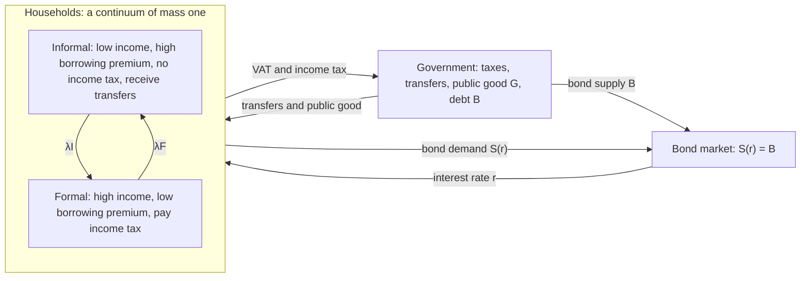
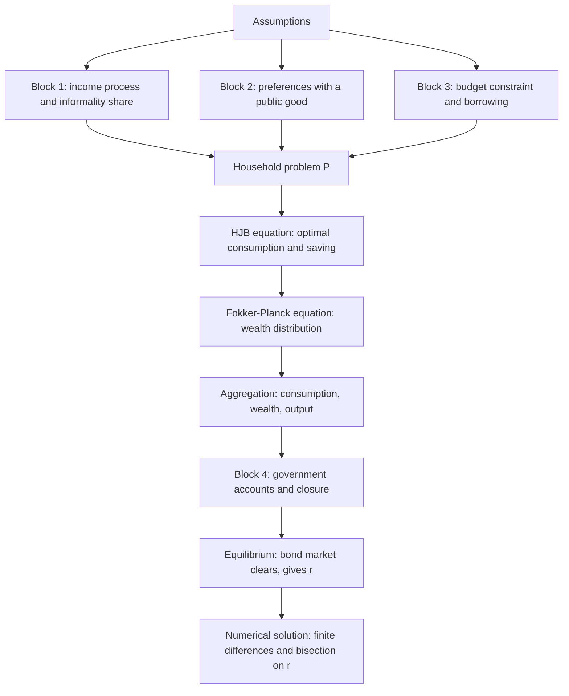
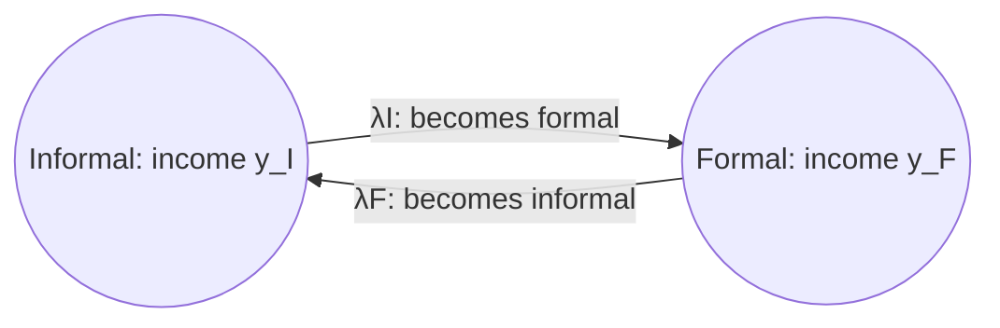
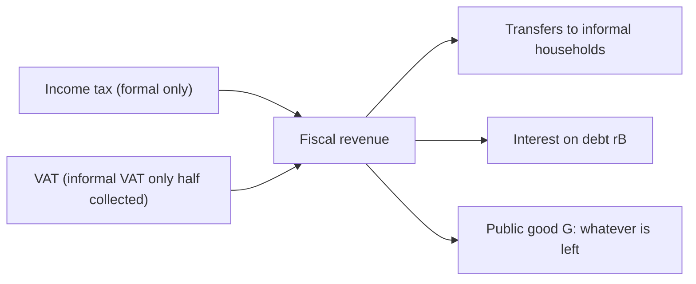
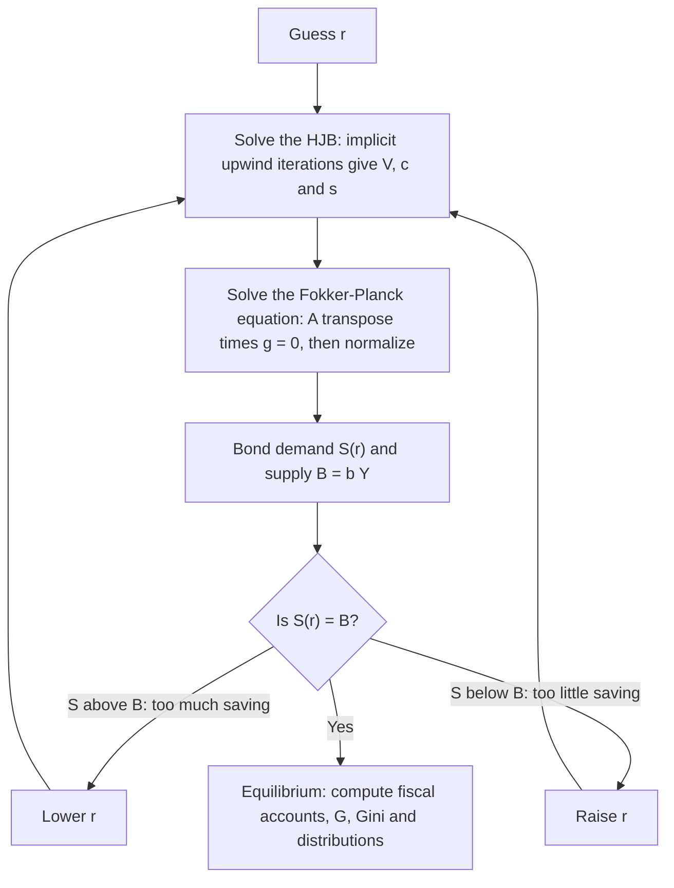

> This page explains the model of my M.Sc. thesis in Economic Engineering (UNI, 2025), written with Ian Carrasco Tufino under the supervision of Hamilton Galindo Gil. The paper version, *Effects of Fiscal Policy on the Wealth Distribution: A Heterogeneous-Agent Model with Informality*, is coauthored by the three of us. The model extends the heterogeneous-agent model with informality of Galindo, Ledesma, Yepez and Salinas (2024) and is solved with the continuous-time method of Achdou, Han, Lasry, Lions and Moll (2022). The figures on this page come from my own Python replication of the baseline calibration, which reproduces the equilibrium interest rates reported in the thesis. Code: [fiscal_policy_informality](https://github.com/pcesar-ramosh/fiscal_policy_informality). Back to the [project page](/projects/1_fiscal_policy_informality/).

## The question and the big picture

**Research question.** What are the effects of fiscal policy on the distributions of wealth and consumption in an economy with high informality?

To answer it the model needs three things at once: (i) **informality** (two types of workers who differ in income, taxes and borrowing costs), (ii) **fiscal policy** (taxes, transfers, a public good and public debt), and (iii) **distributions** (many households who differ in wealth, not just two representative agents). A heterogeneous-agent (Huggett-type) model delivers all three.

**Roadmap of the derivation.** Each block below is one piece of this chain.

## Assumptions

| # | Assumption | In the model | Why |
| --- | --- | --- | --- |
| 1 | Endowment economy in continuous time | income is given; no production or capital | isolates the distributional role of fiscal policy |
| 2 | Continuum of households of mass one | each household is "small" and takes prices and fiscal variables as given | allows distributions |
| 3 | Two labor states: informal (I) and formal (F) | income $$y_I < y_F$$ | informal workers earn less (World Bank, 2022) |
| 4 | Exogenous switching between states | two-state Markov (Poisson) process with intensities $$\lambda_I, \lambda_F$$ | informality is structural; fiscal policy does not change it in the model |
| 5 | Incomplete markets | one risk-free government bond; income risk cannot be insured | generates precautionary saving and wealth inequality |
| 6 | Borrowing limit | $$a \geq \underline{a} = -2 y_I$$ for both types | standard in Huggett models |
| 7 | Borrowing premium | borrowers pay $$r + \theta_j$$ with $$\theta_I > \theta_F$$ | informal workers face costlier credit (Horvath, 2018) |
| 8 | Taxes | VAT $$\tau_c$$ on everyone's consumption; income tax only on formal income | informal workers do not pay income tax |
| 9 | Targeted transfers | $$\text{tran}_j = \phi_j y_j$$ with $$\phi_I > 0, \ \phi_F = 0$$ | transfers target low-income households |
| 10 | Public good in utility | enters multiplicatively with consumption | public infrastructure raises the value of private consumption |
| 11 | Public debt | fixed share of output: $$B = \bar b\, Y$$ | the bond is the only asset; its supply is set by the government |
| 12 | Fiscal closure | overall balance equals zero; the public good adjusts | no deficits or surpluses in the stationary state |
| 13 | No aggregate shocks; stationary equilibrium | prices and aggregates are constant | the only risk is idiosyncratic |

**How formal and informal households differ:**

| Feature | Informal (I) | Formal (F) |
| --- | --- | --- |
| Labor income | $$y_I = 0.33$$ | $$y_F = 1$$ |
| Borrowing rate (when a < 0) | $$r + \theta_I$$, with $$\theta_I = 0.06$$ | $$r + \theta_F$$, with $$\theta_F = 0.01$$ |
| Income tax | $$\tau_{yI} = 0$$ | $$\tau_{yF} = 0.15$$ |
| Transfers | $$\phi_I = 0.09$$ of income | none |
| VAT paid on consumption | $$\tau_c = 0.18$$ | $$\tau_c = 0.18$$ |
| Share of VAT that reaches the treasury | $$\chi_I = 0.5$$ | $$\chi_F = 1$$ |
| Disposable non-asset income $$z_j$$ | $$(1+\phi_I)\,y_I = 0.360$$ | $$(1-\tau_{yF})\,y_F = 0.85$$ |

## Block 1: the income process and the size of informality

### From probabilities to intensities

Over a short interval of length Δ, an informal worker becomes formal with probability proportional to Δ:

$$
\Pr\left[y_{t+\Delta} = y_F \mid y_t = y_I\right] = \lambda_I \Delta + o(\Delta), \qquad
\Pr\left[y_{t+\Delta} = y_I \mid y_t = y_I\right] = 1 - \lambda_I \Delta + o(\Delta)
$$

and symmetrically a formal worker becomes informal at rate $$\lambda_F$$. Here $$o(\Delta)$$ collects terms that vanish faster than Δ. The **intensity** λ is "the probability of switching per unit of time". The probability of *not* switching during an interval of length Δ is $$e^{-\lambda \Delta}$$, and the expected time spent in a state is $$1/\lambda$$.

The whole process is summarized by the **generator matrix**, whose rows add up to zero (what leaves a state goes to the other):

$$
\Lambda = \begin{pmatrix} -\lambda_I & \lambda_I \\ \lambda_F & -\lambda_F \end{pmatrix}
$$

### Deriving the informality share

Let $$\eta_t$$ be the share of informal workers. Over a short interval, informal workers *arrive* from the formal sector and *leave* to it:

$$
\frac{d\eta_t}{dt} = \underbrace{\lambda_F\,(1-\eta_t)}_{\text{inflow from formality}} - \underbrace{\lambda_I\,\eta_t}_{\text{outflow to formality}}
$$

In a stationary state $$d\eta/dt = 0$$, so

$$
\lambda_F (1-\eta) = \lambda_I \eta
\quad \Longrightarrow \quad
\eta = \frac{\lambda_F}{\lambda_I + \lambda_F}
\quad \Longleftrightarrow \quad
\lambda_I = \frac{1-\eta}{\eta}\,\lambda_F
$$

### Calibration of the intensities

1. Formal persistence: the probability of staying formal for a year is $$p_{FF} = e^{-\lambda_F} = 0.8155$$, so $$\lambda_F = -\ln p_{FF} = 0.204$$. On average a formal job lasts $$1/\lambda_F \approx 4.9$$ years.
2. Informality target: with $$\eta = 0.654$$, the formula above gives $$\lambda_I = \frac{0.346}{0.654} \times 0.204 = 0.108$$. On average a spell of informality lasts $$1/\lambda_I \approx 9.3$$ years.

**Key intuition for later:** in this calibration, a *higher* informality share η means a *lower* exit rate from informality $$\lambda_I$$. Falling into informality becomes more persistent, which makes every household more cautious.

## Block 2: preferences and the public good

All households have the same CRRA preferences, where the per-capita public good $$G$$ multiplies private consumption:

$$
U(c, G) = \frac{\left[c\,(1+\psi_G\, G)^{\omega_G}\right]^{1-\gamma}}{1-\gamma}, \qquad \gamma = 2.9, \;\; \psi_G = 0.08, \;\; \omega_G = 0.5
$$

| Parameter | Role |
| --- | --- |
| γ | relative risk aversion (the same for both types) |
| $$\psi_G$$ | how strongly the public good affects utility ($$\psi_G = 0$$: no effect) |
| $$\omega_G$$ | elasticity of the benefit: below 1, diminishing returns to the public good |

### Step 1: separate the public good from consumption

Because powers multiply, the utility function splits into a constant times a standard CRRA function:

$$
U(c, G) = \underbrace{(1+\psi_G G)^{\omega_G (1-\gamma)}}_{\equiv\, K(G)} \cdot \underbrace{\frac{c^{1-\gamma}}{1-\gamma}}_{\equiv\, u(c)}
\qquad \Longrightarrow \qquad
U_c(c, G) = K(G)\, c^{-\gamma}
$$

### Step 2: the public good does not change decisions

In a stationary equilibrium $$G$$ is constant, so $$K$$ is a constant. Suppose $$\tilde V_j$$ solves the household problem with utility $$u(c)$$ (the HJB equation derived below). Multiply that equation by $$K$$:

$$
\rho\,(K\tilde V_j) = \max_c \left\{ K u(c) + (K\tilde V_j)'\, s_j + \lambda_j \big(K\tilde V_{-j} - K\tilde V_j\big) \right\}
$$

So $$V_j = K \tilde V_j$$ solves the problem with $$U = K u$$, and the maximizing $$c$$ is the same: **the public good scales welfare but does not move consumption or saving**. This is why it "cancels out" of the optimality conditions.

### Step 3: it still raises welfare

With γ = 2.9 > 1, $$u(c) < 0$$ and $$K = (1+\psi_G G)^{\omega_G(1-\gamma)} < 1$$. Multiplying a negative number by something smaller than one makes it less negative: more public good means higher utility. Since $$K$$ multiplies $$u(c)$$, the absolute gain is larger for households whose utility level differs more, so the public good amplifies welfare differences that come from consumption differences.

## Block 3: the budget constraint

### Income and the interest rate each household faces

Define **disposable non-asset income** (after income tax, plus transfers):

$$
z_j \equiv (1-\tau_{yj})\, y_j + \phi_j\, y_j, \qquad z_I = (1+\phi_I)\,y_I, \quad z_F = (1-\tau_{yF})\,y_F
$$

The interest rate depends on the sign of wealth. Savers earn $$r$$; borrowers pay a type-specific premium:

$$
R_j(a) = \begin{cases} r + \theta_j, & a < 0 \\ r, & a \geq 0 \end{cases}
$$

### Wealth dynamics

The change in wealth is income minus spending on consumption, where VAT makes each unit of consumption cost $$1+\tau_c$$:

$$
\dot a_t = s_j(a_t) = z_j + R_j(a_t)\, a_t - (1+\tau_c)\, c_t, \qquad a_t \geq \underline{a}
$$

| Term | Meaning |
| --- | --- |
| $$z_j$$ | labor income after taxes plus transfers |
| $$R_j(a)\,a$$ | interest earned (a > 0) or paid (a < 0) |
| $$(1+\tau_c)\,c$$ | consumption spending including VAT |
| $$\underline{a} = -2y_I = -0.66$$ | borrowing limit, the same for both types |

Two features matter for the shape of the solution: VAT acts as a **price of consumption**, and the premium θ creates a **kink at a = 0**, because the cost of one more unit of debt jumps from $$r$$ to $$r+\theta_j$$.

## The household problem

Each household chooses a consumption path to solve problem **P**:

$$
\max_{\{c_t\}} \; \mathbb{E}_0 \int_0^\infty e^{-\rho t}\, U(c_t, G)\, dt
\quad \text{s.t.} \quad
\dot a_t = z_{j_t} + R_{j_t}(a_t)\, a_t - (1+\tau_c)\, c_t, \quad a_t \geq \underline{a}, \quad j_t \in \{I, F\} \text{ switching at rates } \lambda_I, \lambda_F
$$

taking the interest rate $$r$$ and all fiscal variables as given. The state of a household is the pair (wealth $$a$$, type $$j$$). The only uncertainty is the switch of type.

## Deriving the Hamilton–Jacobi–Bellman equation

**Strategy:** write the problem in discrete time with periods of length Δ, then let Δ → 0. For the numerical solution the thesis adds a very small **artificial diffusion** $$\sigma_a$$ to wealth. It has no economic meaning: it smooths the distribution and helps the algorithm converge. With $$\sigma_a = 0$$ everything below collapses to the standard model.

### Step 1: the Bellman equation over a short period

With discount factor $$e^{-\rho \Delta}$$ and probability $$e^{-\lambda_j \Delta}$$ of keeping the same type:

$$
V_j(a_t) = \max_{c_t} \Big\{ U(c_t)\,\Delta + e^{-\rho\Delta} \Big[ e^{-\lambda_j\Delta}\, \mathbb{E}_t V_j(a_{t+\Delta}) + \big(1-e^{-\lambda_j\Delta}\big)\, \mathbb{E}_t V_{-j}(a_{t+\Delta}) \Big] \Big\}
$$

$$
a_{t+\Delta} = a_t + \Delta\, s_j(a_t) + \sigma_a \sqrt{\Delta}\, \varepsilon_{t+\Delta}, \qquad \varepsilon_{t+\Delta} \sim N(0, 1)
$$

In words: utility today, plus the discounted expected value tomorrow, averaging over "same type" and "switched type".

### Step 2: first-order approximations

For small Δ, $$e^{-\rho\Delta} \approx 1 - \rho\Delta$$ and $$e^{-\lambda_j\Delta} \approx 1 - \lambda_j\Delta$$. Substituting:

$$
V_j(a_t) = \max_{c} \Big\{ U(c)\Delta + (1-\rho\Delta)\Big[ (1-\lambda_j\Delta)\,\mathbb{E}_t V_j(a_{t+\Delta}) + \lambda_j\Delta\, \mathbb{E}_t V_{-j}(a_{t+\Delta}) \Big] \Big\}
$$

### Step 3: subtract, rearrange and divide by Δ

Subtract $$(1-\rho\Delta)V_j(a_t)$$ from both sides, divide by Δ, and drop terms of order Δ:

$$
\rho V_j(a_t) = \max_{c} \Big\{ U(c) + (1-\rho\Delta)\Big[ \frac{\mathbb{E}_t V_j(a_{t+\Delta}) - V_j(a_t)}{\Delta} + \lambda_j\big(\mathbb{E}_t V_{-j}(a_{t+\Delta}) - \mathbb{E}_t V_j(a_{t+\Delta})\big) \Big] \Big\}
$$

### Step 4: the expected change in value (a second-order Taylor expansion)

Write $$\Delta a = a_{t+\Delta} - a_t = s_j\Delta + \sigma_a\sqrt{\Delta}\,\varepsilon$$. Because $$\Delta a$$ is random, expand to **second** order and take expectations:

$$
\mathbb{E}_t V_j(a_t + \Delta a) \approx V_j(a_t) + V_j'(a_t)\,\mathbb{E}_t[\Delta a] + \tfrac{1}{2} V_j''(a_t)\, \mathbb{E}_t[(\Delta a)^2]
$$

The two moments:

$$
\mathbb{E}_t[\Delta a] = s_j\Delta + \sigma_a\sqrt{\Delta}\;\underbrace{\mathbb{E}_t[\varepsilon]}_{=0} = s_j \Delta
$$

$$
\mathbb{E}_t[(\Delta a)^2] = s_j^2\Delta^2 + 2 s_j \sigma_a \Delta^{3/2}\,\underbrace{\mathbb{E}_t[\varepsilon]}_{=0} + \sigma_a^2 \Delta\, \underbrace{\mathbb{E}_t[\varepsilon^2]}_{=1} = \sigma_a^2\Delta + o(\Delta)
$$

So

$$
\lim_{\Delta \to 0} \frac{\mathbb{E}_t V_j(a_{t+\Delta}) - V_j(a_t)}{\Delta} = V_j'(a)\, s_j(a) + \tfrac{1}{2}\sigma_a^2\, V_j''(a)
$$

This is Itô's lemma at work: the squared shock is of order Δ, so it survives the limit.

### Step 5: the HJB equation

Taking Δ → 0 (and $$\mathbb{E}_t V(a_{t+\Delta}) \to V(a_t)$$ in the switching term):

$$
\boxed{\;\rho V_j(a) = \max_{c} \Big\{ U(c, G) + V_j'(a)\, s_j(a) + \tfrac{1}{2}\sigma_a^2 V_j''(a) + \lambda_j \big[ V_{-j}(a) - V_j(a) \big] \Big\}, \qquad j \in \{I, F\}\;}
$$

| Term | Interpretation |
| --- | --- |
| $$\rho V_j(a)$$ | required "return" on being in state (a, j) |
| U(c, G) | utility flow today (the "dividend") |
| $$V_j'(a)\, s_j(a)$$ | value of the change in wealth (the "capital gain") |
| $$\tfrac{1}{2}\sigma_a^2 V_j''(a)$$ | numerical diffusion (disappears when $$\sigma_a = 0$$) |
| $$\lambda_j [V_{-j} - V_j]$$ | expected gain or loss from switching type |

The HJB is a system of **two coupled equations** (one per type), linked by the switching term.

## Optimal consumption and saving

### First-order condition

Only two terms in the HJB depend on $$c$$: $$U(c)$$ and $$V_j'(a)\,s_j(a)$$, where $$\partial s_j/\partial c = -(1+\tau_c)$$. Setting the derivative to zero:

$$
U_c(c_j) = (1+\tau_c)\, V_j'(a)
$$

**Marginal utility of consuming one more unit = its price including VAT × marginal value of wealth.** Using $$U_c = K(G)\,c^{-\gamma}$$ and solving for $$c$$:

$$
c_j(a) = \Big[ (1+\tau_c)\,(1+\psi_G G)^{\omega_G(\gamma-1)}\; V_j'(a) \Big]^{-1/\gamma},
\qquad
s_j(a) = z_j + R_j(a)\,a - (1+\tau_c)\,c_j(a)
$$

| If ... | then consumption ... | because |
| --- | --- | --- |
| $$V_j'(a)$$ is high (wealth is scarce) | falls | saving is very valuable |
| $$\tau_c$$ rises | falls for a given $$V_j'$$ | consumption is more expensive |
| γ is high | reacts less to V′ | strong desire to smooth consumption |

### The borrowing limit: a state constraint

At $$a = \underline{a}$$ the household cannot keep borrowing, so $$s_j(\underline{a}) \geq 0$$. Translate this into a condition on the value function, step by step:

$$
s_j(\underline{a}) \geq 0
\;\Longleftrightarrow\;
c_j \leq \underline{c}_j \equiv \frac{z_j + R_j(\underline{a})\,\underline{a}}{1+\tau_c}
\;\Longleftrightarrow\;
U_c(c_j) \geq U_c(\underline{c}_j)
\;\Longleftrightarrow\;
V_j'(\underline{a}) \geq \frac{U_c(\underline{c}_j)}{1+\tau_c}
$$

(the second step uses that marginal utility is decreasing). The constraint is feasible: for an informal household at the limit, $$z_I + (r+\theta_I)\,\underline{a} = 0.360 - 0.08 \times 0.66 > 0$$, so it can still consume a positive amount.

### What the HJB implies: the Euler equation

Differentiating the HJB with respect to $$a$$ (envelope theorem, away from the kink at a = 0 and with $$\sigma_a = 0$$) and using $$\partial s_j/\partial a = R_j$$:

$$
\rho V_j' = V_j''\, s_j + R_j\, V_j' + \lambda_j \big(V_{-j}' - V_j'\big)
$$

Along the optimal path, $$\frac{d}{dt} V_j'(a_t) = V_j''\, s_j$$, and from the first-order condition $$\frac{d}{dt}\ln V_j' = -\gamma\, \dot c_j / c_j$$. Combining:

$$
\frac{\dot c_j}{c_j} = \frac{1}{\gamma} \left[ R_j - \rho + \lambda_j \left( \left(\frac{c_{-j}}{c_j}\right)^{-\gamma} - 1 \right) \right]
$$

VAT cancels out (it is a constant price). The bracket explains the policy functions:

- **Formal households** fear becoming informal: $$c_I < c_F$$, so the last term is **positive**. This precautionary motive is strong enough to outweigh $$r < \rho$$, so they **save**.
- **Informal households** expect to become formal and richer: $$c_F > c_I$$, so the last term is **negative**. They consume more today and **dissave**, until they hit the borrowing limit.



## Deriving the Fokker–Planck equation

The HJB tells us what *one* household does. The Fokker–Planck (Kolmogorov forward) equation tells us how the *whole population* is distributed. Let

$$
G_j(a, t) = \Pr\left(a_t \leq a,\; y_t = y_j\right), \qquad g_j(a, t) = \partial_a G_j(a, t)
$$

be the cumulative distribution and the density of households of type $$j$$.

### Step 1: where did today's poor households come from?

Ignore type switches for a moment. Running the wealth equation backward, a household with wealth $$a$$ at $$t+\Delta$$ had, up to terms of order $$o(\Delta)$$,

$$
a_t = a_{t+\Delta} - \Delta\, s_j(a, t+\Delta) - \sigma_a\sqrt{\Delta}\,\varepsilon_{t+\Delta}
$$

So "wealth below $$a$$ tomorrow" is the event "wealth below $$a - \Delta s_j - \sigma_a\sqrt{\Delta}\,\varepsilon$$ today". If households dissave ($$s_j < 0$$), some who are above $$a$$ today will be below it tomorrow.

### Step 2: add type switches (law of total probability)

A household can be of type $$j$$ at $$t+\Delta$$ because it already was (probability $$1-\lambda_j\Delta$$) or because it switched from $$-j$$ (probability $$\lambda_{-j}\Delta$$):

$$
G_j(a, t+\Delta) = (1-\lambda_j\Delta)\; \mathbb{E}\Big[G_j\big(a - h_j,\, t\big)\Big] + \lambda_{-j}\Delta\; \mathbb{E}\Big[G_{-j}\big(a - h_{-j},\, t\big)\Big] + o(\Delta),
\qquad h_j \equiv \Delta s_j + \sigma_a\sqrt{\Delta}\,\varepsilon
$$

### Step 3: Taylor expansions

Expand to second order around $$a$$, using $$\mathbb{E}[h_j] = \Delta s_j$$ and $$\mathbb{E}[h_j^2] = \sigma_a^2\Delta + o(\Delta)$$ (exactly as in the HJB):

$$
\mathbb{E}\big[G_j(a - h_j, t)\big] = G_j - \Delta\, s_j\, \partial_a G_j + \tfrac{1}{2}\sigma_a^2 \Delta\, \partial_{aa} G_j + o(\Delta)
$$

The second term is already multiplied by $$\lambda_{-j}\Delta$$, so only its leading part survives: $$\lambda_{-j}\Delta\, G_{-j}(a, t) + o(\Delta)$$.

### Step 4: subtract, divide by Δ, take the limit

$$
\partial_t G_j(a, t) = -s_j(a)\, \partial_a G_j + \tfrac{1}{2}\sigma_a^2\, \partial_{aa} G_j - \lambda_j G_j + \lambda_{-j} G_{-j}
$$

### Step 5: from the CDF to the density

Differentiate with respect to $$a$$, using $$g_j = \partial_a G_j$$:

$$
\boxed{\;\partial_t g_j(a, t) = -\partial_a\big[s_j(a)\, g_j(a, t)\big] + \tfrac{1}{2}\sigma_a^2\, \partial_{aa} g_j(a, t) - \lambda_j\, g_j(a, t) + \lambda_{-j}\, g_{-j}(a, t)\;}
$$

| Term | Interpretation |
| --- | --- |
| $$-\partial_a[s_j g_j]$$ | transport: saving moves households to the right, dissaving to the left |
| $$\tfrac{1}{2}\sigma_a^2 \partial_{aa} g_j$$ | numerical diffusion |
| $$-\lambda_j g_j$$ | households leaving type j |
| $$+\lambda_{-j} g_{-j}$$ | households arriving from the other type |

### The stationary distribution and its boundary condition

In a stationary equilibrium $$\partial_t g_j = 0$$. Writing the equation with the **probability flux** $$J_j \equiv s_j g_j - \tfrac{1}{2}\sigma_a^2\, \partial_a g_j$$:

$$
0 = -\partial_a J_j(a) - \lambda_j g_j(a) + \lambda_{-j} g_{-j}(a), \qquad J_j(\underline{a}) = 0, \qquad \int_{\underline{a}}^{\infty} \big(g_I + g_F\big)\, da = 1
$$

The no-flux condition says that no mass leaves through the borrowing limit.

**A consistency check.** Integrate the stationary equation for type I over all $$a$$. The flux term vanishes at both ends, leaving $$\lambda_I M_I = \lambda_F M_F$$ with $$M_j = \int g_j\, da$$. Since $$M_I + M_F = 1$$, this gives $$M_I = \lambda_F/(\lambda_I+\lambda_F) = \eta$$: the distribution reproduces Block 1.



## Aggregation

With the densities, every aggregate is an integral:

$$
M_j = \int g_j\, da, \qquad
C_j = \int c_j(a)\, g_j(a)\, da, \qquad
S(r) = \int a\, g_I(a)\, da + \int a\, g_F(a)\, da
$$

$$
Y = y_I M_I + y_F M_F = \eta\, y_I + (1-\eta)\, y_F
$$

**Bond demand** $$S(r)$$ is the total wealth households want to hold at interest rate $$r$$ (savers minus borrowers). Output $$Y$$ falls when informality rises, because informal income is a third of formal income.

## Block 4: the government

### The accounts

| Account | Formula | Baseline value |
| --- | --- | --- |
| Income tax revenue | $$T_\ell = \tau_{yF}\, y_F\, M_F$$ | 0.052 |
| VAT revenue (with compliance χ) | $$T_c = \tau_c\,\big(\chi_I C_I + \chi_F C_F\big)$$ | 0.058 |
| Transfers | $$\text{Tran} = \phi_I\, y_I\, M_I$$ | 0.019 |
| Interest on public debt | $$\text{Int} = r B$$ | 0.009 |
| Public good (residual) | $$G = T_\ell + T_c - \text{Tran} - rB$$ | 0.082 |
| Primary balance | $$RP = T_\ell + T_c - G - \text{Tran}$$ | 0.009 |
| Overall balance | $$RE = RP - rB = 0$$ | 0 |
| Public debt | $$B = \bar b\, Y, \;\; \bar b = 0.80$$ | 0.449 |

Values are in units of output of a formal worker ($$y_F = 1$$), from my replication of the baseline. They match the fiscal figures in the thesis.

### Deriving the public good from the closure

The government budget says revenue pays for spending:

$$
\underbrace{\tau_{yF}\, y_F M_F}_{T_\ell} + \underbrace{\tau_c\big(\chi_I C_I + \chi_F C_F\big)}_{T_c} = G + \underbrace{\phi_I\, y_I M_I}_{\text{Tran}} + rB
$$

Setting the overall balance to zero and solving for $$G$$ gives the residual rule in the table. Two consequences follow directly. More informality shrinks both tax bases (fewer formal incomes, lower consumption, more evasion) and raises transfers, so **the public good falls**. A higher interest rate raises $$rB$$, so it also crowds out the public good.

## Equilibrium

### Definition

A stationary equilibrium is an interest rate $$r^*$$, value functions $$V_j$$, policies $$c_j, s_j$$, densities $$g_j$$ and fiscal variables $$(T_\ell, T_c, \text{Tran}, G, B)$$ such that:

1. Given $$r^*$$, $$V_j$$ solves the HJB and $$c_j, s_j$$ are the optimal policies.
2. Given $$s_j$$, $$g_j$$ solves the stationary Fokker–Planck equation.
3. The government budget holds with $$B = \bar b\, Y$$ and $$G$$ as the residual.
4. The bond market clears: $$S(r^*) = B$$.

| Unknown | Equation that determines it |
| --- | --- |
| $$V_I, V_F$$ (and $$c_j, s_j$$) | two HJB equations plus first-order conditions |
| $$g_I, g_F$$ | two Fokker–Planck equations plus normalization |
| r | bond market: S(r) = B |
| B | debt rule: $$B = \bar b\, Y$$ |
| G | government budget (overall balance = 0) |

### Why the interest rate is U-shaped in informality



Informality moves both sides of the market:

- **Supply falls.** $$B = \bar b\,Y$$ and $$Y$$ falls with η, so the dashed line moves left. Less supply means a lower interest rate.
- **Demand has two opposing forces.** (i) *Composition:* more households are poor informal workers, who hold little or negative wealth, so demand falls. (ii) *Precaution:* with higher η informality is more persistent ($$\lambda_I$$ falls), so everyone saves more and demand rises. In the replication, at a fixed rate, force (ii) dominates between 25 and about 50 percent informality and force (i) dominates after that.

From low to baseline informality, supply falls while demand rises: the interest rate falls (4.26 → 2.01 percent). From baseline to high informality, demand collapses faster than supply: the rate rises (2.01 → 3.45 percent).

### Where does output go? The resource constraint

Aggregating the household budgets is a useful accounting check. In a stationary distribution aggregate saving is zero, $$\sum_j \int s_j g_j\, da = 0$$ (exactly when $$\sigma_a = 0$$). Integrating the budget constraints:

$$
(1+\tau_c)\, C = \underbrace{Y - T_\ell + \text{Tran}}_{\sum_j z_j M_j} + \underbrace{rB - \theta_I D_I - \theta_F D_F}_{\text{interest income}},
\qquad D_j \equiv -\int_{\underline{a}}^{0} a\, g_j\, da
$$

where $$D_j$$ is the debt of type $$j$$. Using the government budget to replace $$-T_\ell + \text{Tran} + rB = T_c - G$$:

$$
Y = C + G + \underbrace{\tau_c\,(1-\chi_I)\, C_I}_{\text{VAT not remitted}} + \underbrace{\theta_I D_I + \theta_F D_F}_{\text{borrowing premia}}
$$

Output is used for private consumption and the public good, plus two "leakages" that go to agents outside the model (intermediaries and informal sellers). In the baseline: 0.449 + 0.082 + 0.022 + 0.010 ≈ 0.562 = Y.

## Solving the model numerically

### The grid and the derivatives

Wealth is discretized on 700 equally spaced points between $$\underline{a} = -0.66$$ and $$a_{max} = 3$$, with step $$\Delta a$$. Write $$V_{i,j} = V_j(a_i)$$. Derivatives become finite differences:

$$
\text{forward: } \partial_F V_{i,j} = \frac{V_{i+1,j} - V_{i,j}}{\Delta a}, \qquad
\text{backward: } \partial_B V_{i,j} = \frac{V_{i,j} - V_{i-1,j}}{\Delta a}, \qquad
\text{second: } \frac{V_{i+1,j} - 2V_{i,j} + V_{i-1,j}}{(\Delta a)^2}
$$

### The upwind scheme

Which first difference to use depends on the direction in which wealth moves (see my [HA in Asset Pricing notes](/notes/ha-asset-pricing/#solving-the-hjb-equation-numerically) for the intuition):

| Saving at grid point i | Use | Consumption |
| --- | --- | --- |
| positive (forward saving $$s_F > 0$$) | forward difference | from the FOC with the forward difference |
| negative (backward saving $$s_B < 0$$) | backward difference | from the FOC with the backward difference |
| neither | no difference | $$c = (z_j + R_j a_i)/(1 + \tau_c)$$, so that saving is zero |

At the two ends of the grid the derivative is set so that saving is zero (the state constraints).

### The HJB as a linear system

Collect the drift, diffusion and switching terms in a sparse **transition matrix** $$\mathbf{A}$$. For type $$j$$, row $$i$$ has three nonzero entries:

$$
x_i = -\frac{\min(s_{B,i}, 0)}{\Delta a} + \frac{\sigma_a^2}{2(\Delta a)^2}, \qquad
y_i = -\frac{\max(s_{F,i}, 0)}{\Delta a} + \frac{\min(s_{B,i}, 0)}{\Delta a} - \frac{\sigma_a^2}{(\Delta a)^2}, \qquad
z_i = \frac{\max(s_{F,i}, 0)}{\Delta a} + \frac{\sigma_a^2}{2(\Delta a)^2}
$$

multiplying $$V_{i-1}, V_i, V_{i+1}$$. Switching adds $$-\lambda_j$$ on the diagonal and $$+\lambda_j$$ in the column of the other type:

$$
\mathbf{A} = \begin{pmatrix} \mathbf{A}_I - \lambda_I \mathbf{I} & \lambda_I \mathbf{I} \\ \lambda_F \mathbf{I} & \mathbf{A}_F - \lambda_F \mathbf{I} \end{pmatrix}
$$

Every row of $$\mathbf{A}$$ adds up to zero: it is the generator of the joint process (wealth, type). The **implicit method** updates the value function by solving

$$
\left[\Big(\frac{1}{\Delta} + \rho\Big)\mathbf{I} - \mathbf{A}^n\right] \mathbf{V}^{n+1} = U(\mathbf{c}^n) + \frac{1}{\Delta}\mathbf{V}^n
$$

until $$\mathbf{V}$$ stops changing. A large step Δ makes this converge in a few iterations.

### The Fokker–Planck equation comes for free

The discretized Fokker–Planck equation uses the **transpose** of the same matrix:

$$
\mathbf{A}^{\top} \mathbf{g} = \mathbf{0}, \qquad \sum_{i,j} g_{i,j}\, \Delta a = 1
$$

Intuitively, $$\mathbf{A}$$ says where each household goes; $$\mathbf{A}^{\top}$$ says where the mass at each point comes from. One equation is replaced by a normalization to pin down the scale.

### Finding the equilibrium interest rate

Because $$S(r)$$ increases with $$r$$ (figure above), **bisection** on $$r$$ converges reliably.

### Calibration

| Parameter | Symbol | Formal | Informal | Source |
| --- | --- | --- | --- | --- |
| Discount rate | ρ | 0.08 | 0.08 | calibration |
| Risk aversion | γ | 2.9 | 2.9 | calibration |
| Borrowing premium | θ | 0.01 | 0.06 | calibration |
| Borrowing limit | $$\underline{a}$$ | −0.66 | −0.66 | twice informal income |
| Income | y | 1.00 | 0.33 | Galindo et al. (2024) |
| Income tax | $$\tau_y$$ | 0.15 | 0 | based on Galindo et al. (2024) |
| VAT | $$\tau_c$$ | 0.18 | 0.18 | Peru's VAT (SUNAT) |
| VAT compliance | χ | 1 | 0.5 | calibration |
| Transfers | φ | 0 | 0.09 | based on the Juntos program |
| Informality share | η | 0.654 (also 0.25 and 0.80) | | Galindo et al. (2024) |
| Formal persistence | $$p_{FF}$$ | 0.8155 | | Galindo et al. (2024) |
| Public good weight and elasticity | $$\psi_G, \omega_G$$ | 0.08, 0.5 | | calibration |
| Debt-to-output ratio | b̄ | 0.80 | | IMF, emerging economies |
| Grid and diffusion | $$I, a_{max}, \sigma_a$$ | 700, 3.0, 0.01 | | numerical |

### Replication check

| Scenario | Informality η | Output Y | Debt B | r* (thesis) | r* (my replication) |
| --- | --- | --- | --- | --- | --- |
| Low informality | 0.25 | 0.833 | 0.666 | 4.26% | 4.26% |
| Baseline | 0.654 | 0.562 | 0.449 | 2.01% | 2.01% |
| High informality | 0.80 | 0.464 | 0.371 | 3.44% | 3.45% |

## The model in one table

| Block | Equation |
| --- | --- |
| Income process | switching rates $$\lambda_I, \lambda_F$$ with $$\eta = \lambda_F/(\lambda_I + \lambda_F)$$ |
| Preferences | $$U = (1+\psi_G G)^{\omega_G(1-\gamma)}\, c^{1-\gamma}/(1-\gamma)$$ |
| Budget | $$s_j = z_j + R_j(a)\,a - (1+\tau_c)\,c$$, with $$a \geq \underline{a}$$ |
| HJB | $$\rho V_j = \max_c \{U + V_j' s_j + \tfrac{1}{2}\sigma_a^2 V_j'' + \lambda_j (V_{-j} - V_j)\}$$ |
| First-order condition | $$U_c(c_j) = (1+\tau_c)\, V_j'(a)$$ |
| Fokker–Planck | $$0 = -\partial_a(s_j g_j) + \tfrac{1}{2}\sigma_a^2 \partial_{aa} g_j - \lambda_j g_j + \lambda_{-j} g_{-j}$$ |
| Government | $$G = T_\ell + T_c - \text{Tran} - rB$$, with $$B = \bar b\, Y$$ |
| Bond market | $$\int a\,(g_I + g_F)\, da = B$$ |

## References

- Achdou, Y., J. Han, J.-M. Lasry, P.-L. Lions and B. Moll (2022). Income and wealth distribution in macroeconomics: A continuous-time approach. *Review of Economic Studies* 89(1), 45–86.
- Carrasco Tufino, I., H. Galindo Gil and P. C. Ramos Huarachi Effects of fiscal policy on the wealth distribution: A heterogeneous-agent model with informality. Paper version of the M.Sc. thesis, Universidad Nacional de Ingeniería.
- Galindo, H., A. Ledesma, L. Yepez and C. Salinas (2024). Informality and wealth distribution: A heterogeneous agent model. Working Paper 2024-005, Banco Central de Reserva del Perú.
- Horvath, M. (2018). Business cycles, informal economy, and interest rates in emerging countries. *Journal of Asian Economics* 54, 32–45.
- Huggett, M. (1993). The risk-free rate in heterogeneous-agent incomplete-insurance economies. *Journal of Economic Dynamics and Control* 17(5–6), 953–969.
- World Bank (2022). *The Long Shadow of Informality: Challenges and Policies*. Washington, DC.
